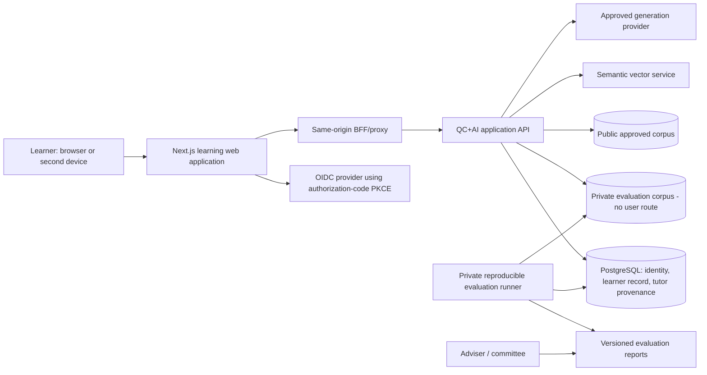
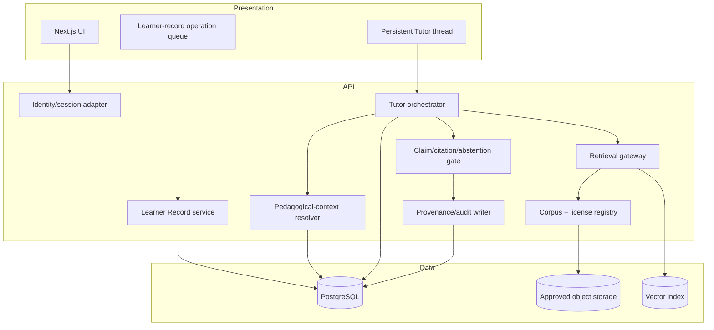
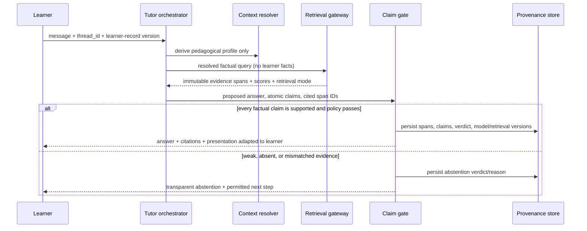
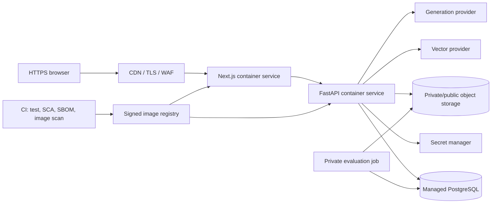
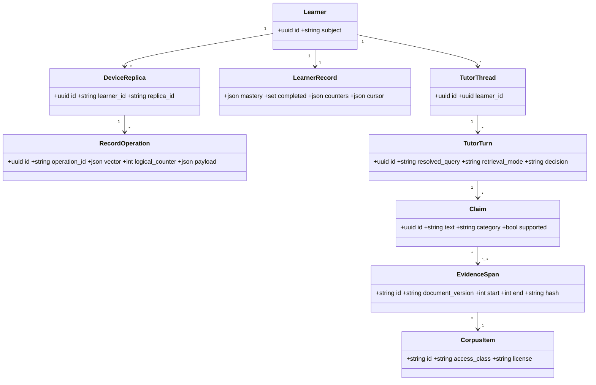

# QC+AI Studio: CS595 Repository Transformation Blueprint

**Authority and snapshot.** This document is a modernization blueprint, not a claim of completed CS595 work. The sole scope authority is *CS595 Software Engineering Project Proposal, Revision B* (6 August 2026), cited below as `RevB §x` with its PDF page number. Repository evidence was collected on 27 August 2026 from commit `6449bf1`. Existing work is preliminary work under `RevB §4.1`; only the increment, evaluation, and thesis artifacts produced during enrollment can be claimed as CS595 work. See [`CS595_IMPLEMENTATION_STATUS.md`](CS595_IMPLEMENTATION_STATUS.md) for the dated implementation state; it does not supersede this requirement model.

## Executive Assessment

QC+AI Studio is a substantial starting platform: FastAPI, Next.js, a relational persistence layer, local and Auth0-capable authentication, lexical and optional hybrid retrieval, source citations, tests, containerization, and operational hardening are all present. It is **not CS595-ready yet** because the proposal defines a higher bar than feature presence. In particular, the repository does not yet demonstrate the new enrollment-period increment, corpus license segregation, claim-to-span enforcement, deterministic learner-record convergence, the 120-200 item frozen LQS with inter-rater protocol, the four-arm ablation, or the required architecture/thesis evidence package.

The correct transformation is to preserve useful existing foundations, establish a versioned evidence boundary between corpus facts and learner-state pedagogy, add a convergent learner record, and make evaluation reproducible and independently auditable. No pre-existing feature should be relabeled as a CS595 deliverable without a dated enrollment-period change record and verification evidence.

| Area | Current assessment | Transformation decision |
| --- | --- | --- |
| Product foundation | Mature preliminary platform | Retain and refactor behind explicit bounded-context interfaces. |
| Durable identity | Local sessions plus Auth0 PKCE path exist | Finish provider policy, session lifecycle, identity linking, and security verification. |
| Learner record | Persisted events/notes/attempts, derived progress | Replace derived-only progress with an authoritative, versioned, convergent record. |
| Grounded tutor | Retrieval, citations, and fallback exist | Add a claim gate, immutable span provenance, abstention policy, and persistent threads. |
| Corpus governance | Curated source assets are directly assembled and served | Separate public licensed corpus from private evaluation corpus before further distribution. |
| Evaluation | Basic tests and an external `Working_Data` RC1 set exist | Build an in-repository reproducible LQS/evaluation harness; RC1 (88 items) is pre-freeze and below the proposed range. |
| Thesis evidence | Readme/logs exist; no CS595 ADR/UML/RTM package | Create the required evidence package and link every requirement to test/result/artifact. |

## Proposal Requirements Model

### Objectives and research questions

| ID | Normalized requirement | Proposal source |
| --- | --- | --- |
| O1 | Analyze requirements and stakeholders for a grounded QC+AI learning platform. | RevB §5.1, p. 6 |
| O2 | Design a layered, secure AI-native architecture documented with ADRs. | RevB §5.1, p. 6 |
| O3 | Implement and test the enrollment-period increment: durable identity, persistent grounded Tutor, and cross-device Learner Record. | RevB §§4.3, 5.1, 6.1, pp. 5-8 |
| O4 | Establish retrieval, citation, abstention on weak evidence, and graceful lexical fallback. | RevB §5.1, p. 6; §6.2, p. 9 |
| O5 | Evaluate functional, integration, system, accessibility, performance, security, AI-grounding, and usability/acceptance dimensions. | RevB §§5.1, 8, pp. 6, 10-12 |
| O6 | Document methodology and personal contribution; distill a reusable architecture pattern and roadmap. | RevB §5.1, p. 6 |
| RQ1 | Measure whether retrieval, citation, and abstention improve faithfulness and correct abstention over no retrieval, including semantic-to-lexical degradation. | RevB §5.2, p. 7 |
| RQ2 | Measure whether progress conditioning changes factual claims or cited sources for the identical question; presentation may vary. | RevB §§5.2, 6.1, 8.1, pp. 7-8, 11 |
| RQ3 | From ADRs and change history, explain what decisions changed, why, and what AI-change defects verification caught. | RevB §5.2, p. 7 |

### Normalized requirements register

`Status` is intentionally absent here; it belongs in the traceability matrix. “Repository” means the tracked `Codex_Webapp_QC_AI_Studio` repository, not adjacent working files.

| ID | Requirement | Proposal source |
| --- | --- | --- |
| GOV-01 | Treat the public platform as preliminary/system-under-study; record the new CS595 scope and enrollment-period contribution separately. | §4.1, p. 4 |
| GOV-02 | Disclose AI assistance and distinguish candidate work, framework defaults, third parties, and AI-assisted boilerplate. | §4.2, p. 5 |
| COR-01 | Maintain a bounded corpus and characterize it rather than inventing arbitrary evaluation scale. | §4.4, pp. 5-6 |
| COR-02 | Serve publicly only open-access, permissively licensed, or public-standards material. | §4.4, p. 6 |
| COR-03 | Keep licensed full text in a private evaluation corpus only, subject to institutional terms. | §4.4, p. 6 |
| COR-04 | Maintain a per-item license register: source, license, permitted use, and public-service status. | §4.4, p. 6; §7, p. 10 |
| COR-05 | Confirm institutional-license scope with the library before G1. | §4.4, p. 6; §10, p. 14 |
| ARCH-01 | Produce layered secure architecture, ADRs, UML, and a requirement-to-test traceability matrix. | §§5.1, 6.3-6.4, pp. 6, 9 |
| ID-01 | Support durable authenticated learner identity. | §§4.3, 6.1, pp. 5, 8 |
| ID-02 | Use PKCE-based authentication, secure sessions, CSRF protection, strict CSP, and hardened response headers. | §6.3, p. 9 |
| LR-01 | Persist a Learner Record that preserves progress across devices. | §§4.3, 6.1, pp. 5, 8 |
| LR-02 | Merge mastery by maximum, completed items by set union, attempts by grow-only counter, and cursor by LWW. | §6.1, p. 8 |
| LR-03 | Use logical timestamps; randomized concurrent interleavings must converge with no completion loss. | §6.1, p. 8 |
| TUT-01 | Provide a persistent source-grounded AI Tutor aware of learner progress. | §§4.3, 6.1, pp. 5, 8 |
| TUT-02 | Keep pedagogical learner-state context separate from evidential corpus context. | §6.1, p. 8 |
| TUT-03 | Bind every factual sentence to retrieved span identifiers; withhold unsupported sentences or abstain. | §6.1, p. 8 |
| TUT-04 | Resolve multi-turn context without query poisoning or evidence anchoring; judge abstention against the resolved query. | §6.1, pp. 8-9 |
| GND-01 | Retrieve from the approved corpus and compose constrained citation-bearing answers. | §6.2, p. 9 |
| GND-02 | Abstain when evidence is weak; abstention is a correct outcome. | §6.2, p. 9 |
| GND-03 | Fall back to lexical retrieval if semantic services are unavailable. | §§5.1, 6.2, pp. 6, 9 |
| TST-01 | Implement test-first where practical and map every requirement to a test. | §6, p. 7 |
| DEL-01 | Deliver a thesis-equivalent project document with IEEE citations and required front matter/appendices. | §§6.4, 7, 12, pp. 9-10, 15 |
| DEL-02 | Deliver requirements, specification, design/UML, test documents, representative code, and implementation narrative. | §§6.4, 7, pp. 9-10 |
| DEL-03 | Deliver the working increment, evaluation data/instruments, digital media, and reproducible code/libraries/executables. | §7, p. 10 |
| DEL-04 | Deliver frozen LQS/rubric, per-item ratings, second-rater subsample, agreement statistics, ADR log, and reproducible ablation scripts/results. | §7, p. 10; §§8.1-8.5, pp. 11-13 |
| ETH-01 | Obtain IRB determination before collecting participant data; retain consent/task scripts if human research occurs. | §§7, 8.6, pp. 10, 13 |
| EVAL-01 | Run component tests mapped to IDs; all critical functional requirements pass. | §8, p. 10 |
| EVAL-02 | Run integration/contract tests and verify external-AI available and unavailable fallback paths. | §8, p. 10 |
| EVAL-03 | Run target-browser end-to-end journeys for sign-in, Tutor, and cross-device resume. | §8, p. 10 |
| EVAL-04 | Run automated and manual accessibility tests; zero critical issues and Lighthouse accessibility at least 95. | §8, p. 10 |
| EVAL-05 | Measure LCP < 2.5 s, INP < 200 ms, CLS < 0.1, and backend load behavior. | §8, p. 10 |
| EVAL-06 | Run CSP/header/CSRF/auth-abuse regression tests, dependency scan, and threat model; leave no critical finding open. | §8, p. 11 |
| EVAL-07 | Evaluate grounding with faithfulness, attribution error, fabrication, correct abstention, and multi-turn abstention decay, each with Wilson intervals and McNemar comparisons. | §8, p. 11; §§8.3-8.5, pp. 12-13 |
| EVAL-08 | Run moderated persona task sessions only after ethics determination; core-task success must exceed 85%. | §8, p. 11 |
| LQS-01 | Freeze a 120-200 item LQS stratified into the seven specified strata. | §8.1, p. 11 |
| LQS-02 | Replay progress-conditioned items at three mastery levels and measure factual-claim/cited-span invariance separately from presentation variation. | §8.1, p. 11 |
| LQS-03 | Freeze the rubric before labeling; second-rate at least a stratified 25% subsample; report Cohen’s kappa with confidence interval and adjudications. | §8.2, p. 12 |
| LQS-04 | Categorize each atomic factual claim exactly once: supported, attribution error, unsupported-but-true, or fabricated; automatically check citation existence. | §8.3, p. 12 |
| ABL-01 | Run four comparable arms: no retrieval, lexical only, semantic without gate, semantic with gate. | §8.4, pp. 12-13 |
| STAT-01 | Use Wilson score intervals, paired McNemar tests, effect sizes, comparison count, and report inconclusive outcomes honestly. | §8.5, p. 13 |
| CASE-01 | Maintain ADRs and dated change/verification records as the RQ3 case-study evidence. | §§5.2, 7, pp. 7, 10 |
| MILE-01 | Obtain G0 scope/approval/registration and G0.5 IRB determination before data collection. | §9, p. 14 |
| MILE-02 | Obtain adviser approval of requirements, architecture, ADRs, and UML by G1; increment/test by G2; evaluation by G3. | §9, p. 14 |
| MILE-03 | Produce adviser-approved draft, committee circulation, mock defense, defense, corrections, signatures, and submission to the stated schedule. | §9, p. 14 |

## Repository Inventory

### Current repository map

```text
Codex_Webapp_QC_AI_Studio/
|- apps/
|  |- api/                         FastAPI service, SQLAlchemy models, Alembic, pytest
|  |  |- app/api/routes/           auth, content, assets, search, qa, assistant, analytics,
|  |  |                            admin, arena, builder, insights, projects, support
|  |  |- app/services/             ingestion/content, retrieval, QA/tutor, learning features
|  |  |- app/core/                 config, DB, auth, rate limit, request protection, assets
|  |  `- tests/                    API, public-operation, seed, deployment tests
|  `- frontend/                    Next.js 16/React 19 application and integration tests
|- infra/                          Cloud Build, Cloud Run examples, Kubernetes manifests
|- seeds/demo/                     Deterministic fictional-demo fixtures
|- transcripts/                    Transcript schema/example
|- update_data/                    Curated source assets
|- tools/package_release.py        Hydrated release packaging
|- docker-compose.yml              Local API + frontend composition
`- README.md                       Existing product/deployment description
```

### Current architecture, modules, APIs, database, and AI

| Concern | Evidence | Assessment |
| --- | --- | --- |
| Frontend | `apps/frontend`: Next.js App Router, React, TanStack Query, same-origin backend proxy, CSP middleware, account/dashboard/Tutor UI. | Functional preliminary web client. |
| Backend | `apps/api/app/main.py` registers fourteen routers; FastAPI uses SQLAlchemy sessions and a health/ready split. | Clear service boundary but application services are not split by CS595 bounded context. |
| APIs | Public course/module/lesson/search; learner progress/notes/quiz; auth; QA and assistant; learning analytics/insights; projects, builder, arena, support, assets, admin. | Broad feature API. No learner-record sync or evaluation API. |
| Database | SQLAlchemy tables include user accounts/sessions, notes, quiz attempts, Q&A interactions, analytics, profile/pulse, projects, arena, builder, support, and web vitals. | Persists interaction records, but has no version vectors, idempotency ledger, Tutor thread/message/claim tables, corpus registry, or evaluation-run model. |
| Authentication | `core/auth.py` resolves Auth0 JWT, local session, demo, or guest identity. Frontend Auth0 login/callback implements authorization-code PKCE. Local sessions use opaque hashed tokens and CSRF cookies. | Foundation exists; provider policy and production evidence are incomplete. |
| Retrieval / Tutor | `retrieval_engine.py` provides lexical search, optional OpenAI embeddings + Pinecone hybrid retrieval, and lexical fallback. QA/assistant responses expose `chunk_id` citations; Assistant can call Vertex or local fallback. | Citation-bearing retrieval exists, but no calibrated abstention gate or atomic claim-to-span enforcement. |
| Tests | Python pytest suite and 104 frontend integration tests passed in this snapshot; frontend also exposes Lighthouse scripts. | Valuable baseline; no CI workflow, browser E2E artifact, formal accessibility audit output, security scan, or grounding evaluation harness was found. |
| Deployment | Docker Compose, Dockerfiles, Cloud Build/Cloud Run configuration examples, and Kubernetes manifests with probes/resource limits/non-root containers. | Multiple deployment descriptions exist; select and document one authoritative CS595 deployment profile. |

### Current public API inventory

| API area | Current operations |
| --- | --- |
| Auth | `GET /auth/me`; local register/login/logout/account deletion; Auth0 browser login/callback/logout routes. |
| Content | Course, module, lesson, progress, notes, quiz attempts. |
| Tutor and retrieval | `GET /search`; `POST /qa/ask`, QA history; `POST /assistant/chat`. |
| Learner features | Analytics events/web vitals; profile, check-ins, adaptive path, skill-gap, feedback; builder, arena, and projects. |
| Operations | Asset streaming, support requests, admin content rebuild, `/health`, `/ready`. |

### Snapshot findings that govern the plan

1. `QAInteraction` stores question/answer/citation JSON, but no durable Tutor-thread model or claim provenance exists.
2. `build_course_progress` derives status from notes, quiz attempts, analytics, and Q&A. It is not a conflict-resolving learner record and has no client operation identifiers or logical clocks.
3. Retrieval already falls back from Pinecone failure/unavailability to local lexical search. The response schema contains chunk IDs, but chunk immutability, document-version identity, citations-to-atomic-claims, and abstention calibration are absent.
4. The application has meaningful CSP, CSRF, session, range-streaming, and rate-limit code. Yet security verification is not a full proposal-compliant program until threat modeling, dependency scanning, abuse testing, and closure evidence are added.
5. The RC1 LQS under the adjacent `Working_Data` area records 88 items and a PASS validation report, but the proposal requires a frozen 120-200 item instrument, a rater protocol, and the reproducible four-arm evaluation in the repository. RC1 is therefore input material, not evidence of completion.

## Requirements Traceability Matrix

The following is the pre-transformation matrix. `Implemented` means the repository contains credible code for the requirement; it does **not** prove the work was completed during enrollment. `Unknown` requires external confirmation rather than an inference.

| Requirement | Repository evidence | Status | Required closure evidence |
| --- | --- | --- | --- |
| GOV-01 | Public status/readme describe a deployed system, but no enrollment-period baseline/tag or signed scope record. | Partial | Signed scope record, baseline tag, dated increment log. |
| GOV-02 | `SUBMISSION_ATTRIBUTION.md` discloses AI assistance. | Partial | Candidate-contribution matrix and change provenance in thesis appendices. |
| COR-01 | Curated document/media lists and `source_assets.py` exist. | Partial | Corpus manifest with immutable version IDs and intended-use class. |
| COR-02 | Source assets are assembled from repository files; no public license filter found. | Missing | Public-corpus manifest and serving gate that rejects non-public items. |
| COR-03 | No private evaluation-corpus boundary is implemented in repository runtime. | Missing | Isolated private storage and no-route/no-image proof. |
| COR-04 | README acknowledges upstream rights but no per-item register. | Missing | Versioned license register and CI validation. |
| COR-05 | No library confirmation artifact found. | Unknown | Written library determination before G1. |
| ARCH-01 | Operational docs exist; no ADR directory, UML package, or proposal RTM. | Missing | Approved documents and IDs linked to automated tests. |
| ID-01 | Local account/session models and Auth0 validation exist. | Partial | Identity-provider policy, account-linking tests, and enrollment-period evidence. |
| ID-02 | Auth0 PKCE browser flow, session cookies, CSP/CSRF/header middleware exist. | Partial | Configuration proof, rotation/revocation tests, threat-model closure. |
| LR-01 | Notes/attempts/events and derived `/content/progress` are persisted. | Partial | Authoritative Learner Record, sync operations, and cross-device test. |
| LR-02 | No per-field merge semantics or replication metadata found. | Missing | Explicit CRDT/LWW implementation and property tests. |
| LR-03 | No logical timestamp, idempotency key, or randomized interleaving test found. | Missing | Convergence proof and replay test report. |
| TUT-01 | Assistant endpoint and UI save interactions but no durable thread/session context. | Partial | Thread/message state, learner-context resolver, and resume test. |
| TUT-02 | Tutor receives page/history but no typed pedagogical-vs-evidential partition. | Missing | Separate contracts and leakage/invariance tests. |
| TUT-03 | Responses include chunk citations, but no sentence/claim binding or gate. | Missing | Claim ledger and fail-closed verifier. |
| TUT-04 | Client-supplied history is sanitized; no resolved-query/audit trail or anchoring controls. | Missing | Context resolver, turn provenance, multi-turn LQS tests. |
| GND-01 | Lexical/hybrid retrieval and citation response models exist. | Partial | Approved-corpus registry, retrieval snapshots, and constrained generation contract. |
| GND-02 | Empty retrieval returns a refusal-like response; no confidence threshold/gate calibration. | Partial | Versioned abstention policy and correct-abstention evaluation. |
| GND-03 | `RetrievalEngine` implements lexical and lexical-fallback modes. | Implemented | Regression and degraded-provider evaluation report. |
| TST-01 | Existing tests cover core/public operations; no RTM links every ID to test. | Partial | Requirement-to-test IDs and CI gate. |
| DEL-01 | Proposal and planning documents are outside the repository; thesis draft absent. | Missing | Graduate-School-formatted final document. |
| DEL-02 | Existing product docs and code exist, but CS595 appendices package is absent. | Missing | Requirements/specification/UML/test artifacts. |
| DEL-03 | Source and release tooling exist. | Partial | Reproducibility manifest and executable evaluation package. |
| DEL-04 | Adjacent RC1 assets exist; no frozen repository LQS/rater/ablation bundle. | Missing | Frozen labeled data, ratings, reliability, run outputs/scripts. |
| ETH-01 | No IRB determination, consent, or approved task script found. | Unknown | IRB determination before participant data collection. |
| EVAL-01 | Pytest suite passed in snapshot. | Partial | Critical-ID map and archived report. |
| EVAL-02 | API/frontend integration tests exist; fallback code exists. | Partial | Contract suite in CI for semantic-on/off conditions. |
| EVAL-03 | No Playwright/Cypress/browser journey suite found. | Missing | Target-browser sign-in/Tutor/resume E2E reports. |
| EVAL-04 | Accessibility-oriented tests and Lighthouse scripts exist. | Partial | Axe/Lighthouse reports plus keyboard/screen-reader record, >=95 and zero critical. |
| EVAL-05 | Web-vitals collection and Lighthouse script exist. | Partial | Controlled trace/load report meeting all proposal thresholds. |
| EVAL-06 | CSP/CSRF/rate limit/auth code and some regression tests exist. | Partial | Threat model, dependency scan, abuse tests, no-open-critical report. |
| EVAL-07 | No claim evaluator, LQS runner, Wilson/McNemar implementation, or ablation output found. | Missing | Frozen-run reports for all four arms. |
| EVAL-08 | No approved moderated-session or task-success dataset found. | Unknown | IRB-authorized study and >85% task-success report. |
| LQS-01 | RC1 has 88 items and stratification, outside repository. | Partial | Freeze 120-200 repository-owned metadata/ratings; keep restricted text private. |
| LQS-02 | No three-level replay/invariance runner found. | Missing | Claim/citation set-comparison output with Wilson interval. |
| LQS-03 | RC1 reports second-rater work as unmeasured. | Partial | Frozen rubric, >=25% stratified second ratings, kappa CI/adjudication. |
| LQS-04 | Citation chunks are exposed, but atomic claim labels and resolution checks are absent. | Missing | Claim-label schema, validator, annotation/rating records. |
| ABL-01 | Lexical and hybrid paths exist; no four-arm runner. | Partial | Fixed-model/question/rubric four-arm results. |
| STAT-01 | No statistical analysis code/report found. | Missing | Wilson, McNemar, effect size, multiplicity output. |
| CASE-01 | Git history and product logs exist; no ADR-linked RQ3 dataset. | Partial | ADR/change/gate-yield case-study ledger. |
| MILE-01 | Approval/registration/IRB state cannot be inferred from code. | Unknown | Signed administrative and IRB records. |
| MILE-02 | No adviser-approved G1 evidence or G2/G3 evidence in repository. | Unknown | Dated committee/adviser approvals and archived runs. |
| MILE-03 | No draft/defense evidence in repository. | Unknown | Committee draft, mock-defense, correction/signature package. |

## Current vs Target Architecture

### Target context diagram



### Target component diagram



### Grounded Tutor data-flow and sequence



The hard rule is that `Context` may control tutoring style only. It cannot influence retrieval scores, evidence selection, factual claim text, citations, or abstention threshold. This realizes `TUT-02` and makes RQ2 testable rather than rhetorical.

### Target deployment diagram



Use one documented production deployment profile (Cloud Run *or* Kubernetes) for the CS595 evaluation environment. Retain the other only as a tested alternative; duplicate, drifting deployment manifests undermine reproducibility.

## Engineering Increment Blueprint

### Durable Learner Identity

| Capability | Design | Primary repository paths |
| --- | --- | --- |
| OIDC identity | Authorization-code PKCE, state/nonce, issuer/audience/JWKS verification, short-lived access token or server-managed session, provider subject bound to internal `learner_id`. | Modify `apps/frontend/src/app/auth/*`, `src/lib/auth.ts`, `apps/api/app/core/auth.py`, `api/routes/auth.py`. |
| Local account policy | Keep local accounts only for approved development/demo use or make them a full production credential system with verified email, password reset, breach/rate-limit policy, session rotation, and account linking. Do not silently run both policies. | Modify `services/local_accounts.py`, `db_models.py`, `schemas.py`, auth tests. |
| Sessions | Store only hashed opaque session tokens; rotate at privilege change/login; revoke by session family; enforce expiry, CSRF, secure/HttpOnly/SameSite cookies, and device/session listing. | New `services/session_service.py`, migration, auth route/tests. |
| Identity migration | Convert a guest record only through explicit authenticated claim/link flow; preserve audit trail and never merge solely by browser cookie. | New `services/identity_linking.py`, record service/migration/tests. |

### Persistent Grounded Tutor

| Capability | Design | Primary repository paths |
| --- | --- | --- |
| Thread persistence | `tutor_threads`, `tutor_messages`, and `tutor_turns` retain user input, resolved query, retrieval mode, model/version, policy decision, and response—not only a flattened interaction. | New models/migration, `services/tutor_orchestrator.py`, `api/routes/assistant.py`. |
| Retrieval | `RetrievalGateway` returns typed, immutable `EvidenceSpan` records with `corpus_item_id`, `document_version_id`, offsets, content hash, retrieval score/mode, and access classification. | Refactor `services/retrieval_engine.py`; new `services/corpus_registry.py`. |
| Citation and span tracking | The UI citation resolves an immutable span ID and source version. A claim record contains exact cited span IDs; citation rendering never reconstructs a source from a display string. | New `services/provenance.py`, `services/claim_gate.py`, frontend Tutor types/component. |
| Abstention | A versioned policy combines retrieval sufficiency, source access, citation resolution, and claim entailment. It returns `answer`, `abstain`, or `clarify`; no model-only answer may be labeled grounded. | New `services/abstention_policy.py`, `services/claim_gate.py`. |
| Lexical fallback | Make lexical retrieval a first-class versioned arm with the same evidence contract; record `lexical` or `lexical-fallback` in every turn. | Modify `retrieval_engine.py`, evaluator, integration tests. |
| Multi-turn correctness | Resolve the next query from typed history; preserve evidence only when it remains relevant; persist raw and resolved query and test anaphora/topic-shift/out-of-corpus turns. | New `services/session_context.py`, evaluator suite. |

### Cross-device Learner Record

The learner record is a domain aggregate, not a dashboard query. The server is the durable authority; clients send idempotent operations and can read a materialized view.

| Record field | Merge rule required by RevB | Storage and conflict rule |
| --- | --- | --- |
| `mastery[skill]` | Maximum | Monotone max by decimal score; retain input operation history. |
| `completed_item_ids` | Set union | OR-set/grow-only set; a completion is never erased by a stale replica. |
| `attempt_count[item]` | Grow-only counter | Per-replica counter components merged by component-wise maximum then summed. |
| `cursor` | Last writer wins | LWW register ordered by `(logical_counter, replica_id)`, not wall clock. |
| `preferences` | Explicit versioned LWW | Same logical-clock ordering; separate from mastery/evidence. |

Protocol: issue each installed client a `replica_id`; persist `operation_id`, causal parent/version vector, logical counter, and payload hash. `POST /learner-record/operations` is idempotent, rejects invalid monotonicity changes, returns the authoritative vector and materialized view, and supports `GET /learner-record?since=<vector>`. Property tests generate divergent operation streams, shuffle/replay them, and assert equal converged state and no lost completion.

### Target API additions

| Endpoint | Contract |
| --- | --- |
| `GET /v1/learner-record` | Materialized record, server vector, and ETag for authenticated learner. |
| `POST /v1/learner-record/operations` | Batch of idempotent signed/validated operations; returns accepted/duplicate/conflict disposition and canonical state. |
| `GET /v1/tutor/threads` / `POST /v1/tutor/threads` | List/create durable Tutor threads. |
| `GET /v1/tutor/threads/{id}` | Thread messages plus provenance summary, scoped to owner. |
| `POST /v1/tutor/threads/{id}/turns` | Returns response, claim/citation records, retrieval mode, and abstention decision. |
| `GET /v1/citations/{span_id}` | Resolves only public/authorized evidence with exact version metadata. |

## Repository Restructuring Plan

### Current structure to target structure

```text
Current                                      Target
-------                                      ------
apps/api/app/services/*               ->    src/api/qcai/{identity,learner_record,tutor,corpus,...}
apps/frontend/src/*                   ->    src/web/* (or retain workspace path but name the boundary)
ad-hoc source documents at repo root  ->    corpus/public/metadata + non-public governed storage
adjacent Working_Data LQS             ->    lqs/{spec,rubric,metadata,ratings}; private spans external
no evaluation package                 ->    evaluation/{loader,retrieval,citation,claim,...,reports}
product/readme logs                   ->    docs/{requirements,architecture,adr,uml,testing,evaluation}
manual release tooling                ->    scripts/{ci,corpus,evaluation,reproducibility,release}
```

Recommended target tree:

```text
docs/
  requirements/  architecture/  adr/  uml/  testing/  evaluation/  thesis/
src/
  api/qcai/{identity,learner_record,tutor,corpus,security,observability}/
  web/{app,components,lib,features}/
evaluation/
  qcai_eval/{lqs_loader,retrieval,citation,claim,faithfulness,fabrication,abstention,invariance,ablation,statistics}/
  tests/  reports/  fixtures/
lqs/
  README.md  schema.json  rubric.md  manifest.jsonl  ratings/  private-data-policy.md
corpus/
  public/{manifest.json,metadata}/  private/README.md  license-register.csv
scripts/
  run_eval.py  validate_lqs.py  validate_corpus.py  reproduce.py  generate_sbom.py
infra/
  environments/{evaluation,production}/  policy/
```

The public Git repository must contain metadata, hashes, and permitted excerpts only. It must not use `lqs/` or a Docker build context to redistribute exclusive-license full text. Private source material must be mounted/read from controlled storage only during authorized evaluation. License classification is a gate, not a comment in a README.

## File-by-File Change Plan

This is every planned touched path. All other tracked source/UI/media files are explicitly **retain unchanged** until a linked requirement, test, and owner justify a change. “Quarantine” means remove from public serving/distribution after license review; it does not authorize deletion of local originals.

| File path | Purpose | Action | Reason / proposal reference | Priority |
| --- | --- | --- | --- | --- |
| `README.md` | Entry point | Modify | State CS595 baseline, reproducible commands, corpus boundary, artifact index. §4.1, §7 | P0 |
| `.github/workflows/ci.yml` | Required CI quality gate | Create | Test, lint, type, SCA, SBOM, docs-link, corpus/LQS validation. §6.3, §8 | P0 |
| `.github/workflows/evaluation.yml` | Reproducible protected evaluation | Create | Run frozen arms only with pinned environment and publish result metadata. §§8.1-8.5 | P0 |
| `.gitignore` | Boundary enforcement | Modify | Ignore private corpus, raw restricted LQS spans, credentials, report PII. §4.4 | P0 |
| `docs/requirements/proposal-requirements.md` | Authoritative normalized register | Create | Preserve source-to-ID mapping. §§4-12 | P0 |
| `docs/requirements/traceability-matrix.md` | RTM | Create | Map each ID to design, code, test, report, status. §6 | P0 |
| `docs/architecture/target-architecture.md` | Architecture specification | Create | Approved layered design and boundaries. O2 | P0 |
| `docs/adr/ADR-001..007.md` | Decision log | Create | RQ3 evidence and architecture governance. §§5.2, 7 | P0 |
| `docs/uml/{context,use-case,sequence,component,class,deployment,data-flow}.puml` | Reviewable UML | Create | Required design appendix package. §§6.4, 7 | P0 |
| `docs/testing/test-strategy.md` | Verification strategy | Create | Eight-dimension mapping and thresholds. §8 | P0 |
| `docs/evaluation/protocol.md` | Reproducible methods | Create | LQS, ratings, arms, statistics, reporting. §§8.1-8.5 | P0 |
| `docs/thesis/artifact-register.md` | Evidence register | Create | Thesis/digital-media/defense collection checklist. §§6.4, 7, 12 | P0 |
| `corpus/public/manifest.json` | Public corpus catalog | Create | License/access/version/hash gate. §4.4 | P0 |
| `corpus/private/README.md` | Private corpus policy | Create | Documents non-distribution and controlled evaluation usage. §4.4 | P0 |
| `corpus/license-register.csv` | Per-item license register | Create | Required source/license/use/public status record. §4.4, §7 | P0 |
| `lqs/schema.json` | LQS contract | Create | Validates strata, items, claims, evidence IDs, replay profile. §8.1-8.3 | P0 |
| `lqs/rubric.md` | Frozen rater rubric | Create then freeze/tag | Prevent post-result category changes. §8.2 | P0 |
| `lqs/manifest.jsonl` | Non-restricted item metadata | Create | 120-200 identifiers/prompts/labels/expected span IDs; no restricted full text. §8.1 | P0 |
| `lqs/ratings/*.jsonl` | Candidate/second-rater labels | Create | Rater identity pseudonym, disagreement/adjudication evidence. §8.2 | P0 |
| `evaluation/qcai_eval/lqs_loader.py` | Validated data loader | Create | Reject unversioned/incomplete/restricted-in-public data. §8.1 | P0 |
| `evaluation/qcai_eval/retrieval.py` | Retrieval evaluator | Create | Recall/sufficiency and lexical-degradation evidence. RQ1 | P0 |
| `evaluation/qcai_eval/citation.py` | Citation resolver/evaluator | Create | Existence/resolution and span linkage. §8.3 | P0 |
| `evaluation/qcai_eval/claims.py` | Atomic claim extraction/labels | Create | Implements taxonomy input/output. §8.3 | P0 |
| `evaluation/qcai_eval/faithfulness.py` | Supported-claim metric | Create | Citation faithfulness by arm. §8.3 | P0 |
| `evaluation/qcai_eval/fabrication.py` | Fabrication metric | Create | False/non-existent evidence rate by arm. §8.3 | P0 |
| `evaluation/qcai_eval/abstention.py` | Correct-abstention metric | Create | Near-miss/adversarial/unanswerable/multi-turn measurement. §§6.2, 8.1 | P0 |
| `evaluation/qcai_eval/invariance.py` | RQ2 evaluator | Create | Three-mastery claim/citation-set comparison. §§6.1, 8.1 | P0 |
| `evaluation/qcai_eval/ablation.py` | Four-arm runner | Create | A-D parity, fixed inputs, provenance. §8.4 | P0 |
| `evaluation/qcai_eval/statistics.py` | Wilson/McNemar/effect sizes | Create | Required statistical treatment. §8.5 | P0 |
| `evaluation/tests/*` | Harness verification | Create | Validate loader, metrics, determinism, no leakage. §8 | P0 |
| `scripts/run_evaluation.py` | Single reproducible runner | Create | Pins arm/model/corpus/LQS configuration. §§7, 8 | P0 |
| `scripts/validate_lqs.py` | LQS gate | Create | Enforce range/strata/rating/completeness rules. §§8.1-8.2 | P0 |
| `scripts/validate_corpus.py` | Corpus gate | Create | Block unregistered/non-public assets from serving/images. §4.4 | P0 |
| `scripts/reproduce.py` | Reproduction entry point | Create | Rebuild reports from tagged inputs. §7 | P0 |
| `apps/api/app/db_models.py` | Persistence model | Modify | Add learner, device, operation, vector, thread, turn, message, evidence, claim, corpus/license/evaluation models. §§6.1-6.2 | P0 |
| `apps/api/alembic/versions/<cs595_increment>.py` | Schema migration | Create | Versioned reversible migration and constraints/indexes. O3 | P0 |
| `apps/api/app/core/config.py` | Runtime policy | Modify | Add corpus manifests, policy versions, private-eval isolation, provider configuration validation. §§4.4, 6.3 | P0 |
| `apps/api/app/core/auth.py` | Identity authorization | Modify | Provider subject linking, session family, role/scopes, fail-closed policy. ID-01/02 | P0 |
| `apps/api/app/core/request_protection.py` | Request security | Modify | Explicit CSRF/session/operation-replay policy coverage. ID-02, EVAL-06 | P0 |
| `apps/api/app/services/local_accounts.py` | Local credentials | Modify | Align local-account policy with durable identity/security decision. ID-01/02 | P1 |
| `apps/api/app/services/learner_progress.py` | Legacy derived dashboard | Modify | Read materialized Learner Record; retain analytics as supplemental signal only. LR-01 | P0 |
| `apps/api/app/services/learner_record.py` | New aggregate service | Create | Typed operations, vector/clock merge, materialization. LR-01-03 | P0 |
| `apps/api/app/services/identity_linking.py` | Guest/account transfer | Create | Explicit claim/link/rollback audit path. ID-01 | P1 |
| `apps/api/app/services/tutor_orchestrator.py` | New Tutor boundary | Create | Separates query resolution, retrieval, pedagogy, generation, gate, persistence. TUT-01-04 | P0 |
| `apps/api/app/services/session_context.py` | Multi-turn resolver | Create | Resolves follow-ups with audit trail and anchoring controls. TUT-04 | P0 |
| `apps/api/app/services/retrieval_engine.py` | Retrieval adapter | Modify | Return immutable spans, deterministic config, public-access filtering, arm selection. GND-01-03 | P0 |
| `apps/api/app/services/claim_gate.py` | Grounding verifier | Create | Atomic claim-span bindings and fail-closed abstention. TUT-03, GND-02 | P0 |
| `apps/api/app/services/abstention_policy.py` | Policy object | Create | Calibrated versioned decision reasons. GND-02 | P0 |
| `apps/api/app/services/corpus_registry.py` | Corpus governance | Create | Manifest/license/access/version lookup. COR-01-04 | P0 |
| `apps/api/app/services/provenance.py` | Trace writer | Create | Audit records for evidence, claims, prompts/config, decisions. TUT-03, CASE-01 | P0 |
| `apps/api/app/services/qa_engine.py` | Legacy answer path | Modify/deprecate | Route through same Tutor/claim gate or remove from evaluation surface. GND-01/02 | P1 |
| `apps/api/app/services/teaching_assistant.py` | Current assistant | Modify/deprecate | Make a provider adapter under orchestrator; forbid direct ungated output. TUT-01-04 | P0 |
| `apps/api/app/api/routes/assistant.py` | Tutor API | Modify | Add owner-scoped thread/turn/provenance endpoints. TUT-01 | P0 |
| `apps/api/app/api/routes/content.py` | Progress API | Modify | Serve Learner Record view; preserve compatible read contract during migration. LR-01 | P0 |
| `apps/api/app/api/routes/auth.py` | Auth endpoint | Modify | Device/session management, explicit link/migration, revocation. ID-01/02 | P1 |
| `apps/api/app/api/routes/citations.py` | Citation resolution | Create | Controlled immutable span lookup. TUT-03, COR-02 | P0 |
| `apps/api/app/api/routes/learner_record.py` | Sync API | Create | Idempotent operations and state/vector response. LR-01-03 | P0 |
| `apps/api/app/main.py` | Composition root | Modify | Register new routers and explicit policy health checks. O2 | P0 |
| `apps/api/app/schemas.py` | API contracts | Modify | Typed span, claim, decision, thread, record operation/vector schemas. O3/O4 | P0 |
| `apps/api/tests/test_auth*.py` | Identity tests | Create/modify | PKCE/session fixation/revocation/linking/abuse coverage. ID-02, EVAL-06 | P0 |
| `apps/api/tests/test_learner_record*.py` | Convergence tests | Create | Property/interleaving/idempotency/no-loss tests. LR-02/03 | P0 |
| `apps/api/tests/test_tutor_grounding*.py` | Tutor gate tests | Create | Claim/span, abstention, multi-turn, leakage invariance tests. TUT-02-04 | P0 |
| `apps/api/tests/test_corpus_governance.py` | License/serving test | Create | Public/private manifest enforcement. COR-02-04 | P0 |
| `apps/frontend/src/lib/api.ts` | Client API layer | Modify | Typed thread, citation, and record-sync calls with retry/idempotency behavior. O3 | P0 |
| `apps/frontend/src/lib/auth.ts` | Browser auth | Modify | Align PKCE/session policy; eliminate ambiguous provider fallback. ID-02 | P1 |
| `apps/frontend/src/lib/learner-record-sync.ts` | Offline/client queue | Create | Replica ID, durable operation queue, conflict/resume state. LR-01-03 | P0 |
| `apps/frontend/src/components/teaching-assistant-chat.tsx` | Tutor UI | Modify | Persistent threads, evidence/citation status, abstention clarity, accessible transcript. TUT-01-04 | P0 |
| `apps/frontend/src/components/learning-dashboard.tsx` | Learner UI | Modify | Display authoritative record/version and resume state. LR-01 | P1 |
| `apps/frontend/src/components/account-console.tsx` | Account UI | Modify | Session/device management and record-link consent. ID-01 | P1 |
| `apps/frontend/src/proxy.ts` | Browser boundary | Modify | Preserve required CSP while documenting/validating production connect sources. ID-02 | P1 |
| `apps/frontend/tests/auth-and-proxy.integration.test.ts` | Web auth/CSP tests | Modify | Extend state/PKCE/session error and CSP assertions. EVAL-06 | P1 |
| `apps/frontend/tests/assistant-*.test.ts` | Tutor UI tests | Modify/create | Citation UX, abstention, persisted thread, keyboard/screen-reader checks. EVAL-04, TUT-01 | P0 |
| `apps/frontend/tests/learner-record*.test.ts` | Sync UI tests | Create | Offline/retry/conflict/resume behavior. LR-01-03 | P0 |
| `apps/frontend/package.json` | Test tooling | Modify | Add browser E2E and axe runner; pin audit commands. EVAL-03/04 | P0 |
| `apps/frontend/scripts/run-lighthouse-audit.mjs` | Browser audit | Modify | Emit retained reports and enforce specified thresholds. EVAL-04/05 | P0 |
| `infra/environments/evaluation/*` | Reproducible isolated stack | Create | Private corpus/evaluator isolation and pinned service configuration. §§4.4, 8 | P0 |
| `infra/{k8s,cloudrun}/*` | Deployment definitions | Modify/archive alternative | Select one tested source of production deployment truth. O2, §10 | P1 |
| Root source DOCX/PDF/MP4 assets and `update_data/*` | Current corpus/media | Quarantine/reclassify, not delete blindly | Register/license each; do not serve or redistribute any restricted item. §4.4 | P0 |
| `tools/package_release.py` | Release packaging | Modify | Call corpus validator and exclude private/restricted material by default. COR-02/03 | P0 |

## ADR Package

Each ADR is immutable after acceptance; a superseding ADR, rather than silent editing, records later change. Store decision, context, alternatives, evidence, consequence, and status in `docs/adr/`.

| ADR | Purpose and decision | Consequences |
| --- | --- | --- |
| ADR-001: Grounding Separation | Establish two typed channels: pedagogical learner state can alter presentation; evidential corpus spans alone support factual claims/citations. | Enables RQ2 invariance test; requires separate prompt contracts and leakage tests; limits personalization that changes evidence selection. |
| ADR-002: Retrieval Architecture | Adopt a `RetrievalGateway` with canonical lexical retrieval, optional semantic/hybrid adapter, immutable evidence spans, deterministic configuration, and lexical fallback. | Provider independence and measured arm B; requires versioned corpus/index snapshots and avoids provider-specific result IDs. |
| ADR-003: Learner Record Synchronization | Use operation-based convergent record semantics: max-register mastery, grow-only completion set/counters, logical-clock LWW cursor/preferences, idempotent operations. | More schema/protocol complexity than last-write-wins; gains no-loss cross-device convergence and a falsifiable test claim. |
| ADR-004: Citation Traceability | Make citation a reference to immutable corpus/document/span version and bind every atomic factual claim to one or more such IDs. | Citation display becomes auditable; requires provenance storage, resolution API, and corpus version lifecycle. |
| ADR-005: Abstention Gate | Generate a response only when retrieval and claim-span verification satisfy a versioned policy; otherwise clarify or abstain with a reason. | Better truthfulness and measurable correct abstention; may reduce answer coverage and needs policy calibration. |
| ADR-006: Security Model | Use OIDC authorization-code PKCE, server-enforced scopes/session lifecycle, CSRF, nonce CSP, secure headers, secret management, SCA/SBOM, and threat-model gates. | Establishes a verifiable production model; local/demo access must be explicitly constrained and tested, not an implicit production fallback. |
| ADR-007: Evaluation Harness | Keep LQS metadata/rubric/evaluator code versioned; isolate restricted spans; run fixed four-arm experiments with replayable configs and statistical reports. | Produces reproducible RQ1/RQ2 evidence; adds annotation, privacy, and protected-data handling obligations. |

## UML Package

| Diagram | Required content | Repository mapping |
| --- | --- | --- |
| Context | Learner, committee/evaluator, web UI, API, IdP, public/private corpus, model/vector providers. | `apps/frontend`, `apps/api`, external services, `evaluation`. |
| Use case | Sign in, resume on another device, sync offline operations, ask Tutor, inspect citation, abstention, run evaluation, approve corpus. | UI routes/components, new identity/record/Tutor/corpus services. |
| Sequence | Tutor turn with context separation, retrieval, claim gate, abstention, provenance. | `tutor_orchestrator`, `session_context`, `retrieval_engine`, `claim_gate`. |
| Component | Identity, Learner Record, Tutor, retrieval, corpus registry, provenance, evaluator, UI/BFF. | New bounded modules plus existing composition roots. |
| Class | Learner, DeviceReplica, RecordOperation, VectorClock, TutorThread, TutorTurn, EvidenceSpan, Claim, CorpusItem, LicenseEntry, EvaluationRun. | New SQLAlchemy models and Pydantic contracts. |
| Deployment | Browser/edge, frontend, API, managed Postgres/object storage, vector/model provider, private evaluation job, CI/registry. | `infra`, containers, scripts. |
| Data flow | Public vs private corpus, learner personal data, model prompt/provenance, evaluation outputs. | Corpus registry, Tutor, evaluation isolation. |

### Core class model



## Evaluation Harness Design

### Modules and contracts

| Module | Input | Output | Proposal section |
| --- | --- | --- | --- |
| LQS Loader | Frozen manifest, rubric version, corpus snapshot | Validated stratum/replay worklist | §8.1-8.2 |
| Retrieval Evaluator | Resolved query, expected spans, arm config | Ranked-span/sufficiency results | RQ1, §8.4 |
| Citation Evaluator | Claims and citation IDs | Citation existence/resolution/attribution result | §8.3 |
| Claim Evaluator | Answer and frozen ratings | Atomic claim records in exclusive taxonomy | §8.3 |
| Faithfulness Evaluator | Supported claims / all factual claims | Citation-faithfulness rate + Wilson CI | §8.3 |
| Fabrication Evaluator | Fabricated claims / all factual claims | Fabrication rate + Wilson CI | §8.3 |
| Abstention Evaluator | Expected answerability and decision | Correct-abstention and turn-depth decay | §§6.1, 6.2, 8.1 |
| Invariance Evaluator | Three mastery replays per item | Claim/cited-span-set violations + presentation deltas | RQ2, §8.1 |
| Ablation Runner | Pinned model/corpus/LQS/seed for A-D | Arm outputs, pairings, environment/provenance manifest | §8.4 |
| Statistics | Paired binary outcomes and denominators | Wilson CI, McNemar p-value/effect size, multiplicity statement | §8.5 |

Evaluation rules:

1. Freeze and tag corpus manifest, LQS manifest, rubric, model/provider version, retrieval config, prompt/gate policy, and evaluator package before collecting an arm’s results.
2. Use the same questions, model, run settings, and rubric across all four arms. Arm A is parametric/no retrieval; B is lexical only; C semantic retrieval/no abstention gate; D semantic retrieval/abstention gate.
3. Do not place private full-text spans in result bundles. Store IDs/hashes and authorized-location references; reviewers with permission reproduce against the protected corpus.
4. Report stratum denominator, point estimate, Wilson interval, pairwise McNemar comparison, effect size, number of comparisons, missing/failed runs, and any result too imprecise to discriminate.
5. For RQ2, compare factual-claim and cited-span **sets**, not prose. Record presentation changes separately to show learner conditioning operated.

## Testing Framework

| Layer | Test design | Primary evidence |
| --- | --- | --- |
| Functional | Requirement-ID unit/property tests for auth, merge algebra, claim gate, license gate, prompt policy. | JUnit/pytest report and RTM links. |
| Integration | API/database/IdP mocks, semantic provider on/off, vector failure, asset/corpus access contracts. | CI integration report. |
| System | Browser E2E: sign in, start on device A, resume on B, Tutor thread/citation/abstention, logout/session revoke. | Playwright traces/video/screenshots on target browsers. |
| Accessibility | axe per route/component, Lighthouse, keyboard-only task script, NVDA/VoiceOver screen-reader review. | JSON/HTML reports and manual checklist. |
| Performance | Lighthouse/Web Vitals on a production-like deployment; k6/Locust API load and database connection analysis. | Raw metrics, thresholds, run config. |
| Security | Threat model, SAST/SCA/SBOM/image scan, DAST smoke, PKCE/CSRF/session fixation/authz/rate-limit abuse tests. | Risk register and closed-findings report. |
| AI grounding | Frozen LQS, citation/claim/abstention/multi-turn/invariance tests, four-arm ablation. | Versioned reports and raw machine-readable results. |
| Usability | IRB-authorized moderated persona tasks with counterbalanced scripts where appropriate. | Consent/ethics references, task outcomes, coded observations. |

## Thesis Artifact Package

| Artifact | Repository location | Evidence owner / gate |
| --- | --- | --- |
| Requirements specification and RTM | `docs/requirements/` | Candidate, approved G1 |
| Architecture specification, ADR log, UML | `docs/architecture`, `docs/adr`, `docs/uml` | Candidate/adviser, approved G1 |
| Security threat model and license register | `docs/security/`, `corpus/license-register.csv` | Candidate; library confirmation before G1 |
| Test strategy, raw reports, defect log | `docs/testing/`, CI artifacts | QA evidence through G2/G3 |
| LQS/rubric/rating protocol | `lqs/` plus protected rating storage | Candidate/second rater, freeze before labeling |
| Evaluation code/config/reports | `evaluation/`, `docs/evaluation/` | Candidate, G3 |
| Reproducibility package/SBOM | `scripts/`, release artifact manifest | Candidate, G3/G4 |
| Candidate contribution and AI disclosure matrix | `docs/thesis/contribution-statement.md` | Candidate, G4 |
| IRB determination, consent/task scripts | `docs/thesis/ethics/` access-controlled as needed | IRB before participant data |
| Defense artifacts | `docs/thesis/defense/` (slides, demo runbook, Q&A, mock-defense record) | G5/G6 |
| Final thesis-equivalent document/digital media | external Graduate School package, indexed from docs | G7 |

## Research Alignment Matrix

| Repository component | O1-O6 alignment | RQ1 | RQ2 | RQ3 |
| --- | --- | --- | --- | --- |
| Requirements/RTM and stakeholder record | O1, O5, O6 | Defines outcomes | Defines invariance scope | Links changes/gates |
| ADR/UML/architecture specification | O2, O6 | Retrieval/gate design | Channel separation design | Primary case-study data |
| Identity/session service | O3, O5 | Controls authentic runs | Preserves learner identity/state | Security-decision history |
| Learner Record and sync protocol | O3, O5 | Supplies controlled state | Creates three mastery conditions | Convergence defect evidence |
| Tutor orchestrator/claim gate | O3, O4, O5 | Arms, citation, abstention | Prevents evidence/pedagogy leakage | Gate-yield evidence |
| Retrieval/corpus registry | O2, O4, O5 | Semantic/lexical/no-retrieval comparison | Locks cited spans | Provider/corpus ADR revisions |
| LQS/evaluation/statistics | O4, O5, O6 | Main experiment | Main invariance experiment | Reproducible methods/history |
| CI/security/a11y/performance reports | O5, O6 | Controls engineering quality | Controls presentation path | Defect classes caught |

## Defense Readiness Review

Scores are evidence-maturity estimates for the current snapshot, not grades.

| Area | Score / 100 | Evidence-based assessment |
| --- | ---: | --- |
| Architecture | 70 | Sound implementation structure, but no approved CS595 architecture/ADRs/UML/bounded context model. |
| Security | 66 | Strong code-level foundations; no completed threat model/SCA/abuse/closure evidence. |
| Grounding | 40 | Retrieval/citations/fallback exist; claim gate, immutable spans, calibrated abstention, and corpus segregation are absent. |
| Testing | 57 | 85 backend and 104 frontend tests passed in this snapshot; no CI-attested E2E/property/evaluation program. |
| Accessibility | 55 | Semantics and audit scripts exist; no recorded axe/manual screen-reader evidence or threshold report. |
| Evaluation | 18 | RC1 work is promising input, but the required frozen LQS/harness/arms/statistics are absent. |
| Documentation | 45 | Product logs/readme exist; CS595 requirements/ADRs/UML/RTM/test/evaluation artifacts are absent. |
| Publication readiness | 20 | The research question is credible; reproducible experimental evidence is not yet available. |
| Defense readiness | 30 | Preliminary platform can be demoed, but the accepted increment, evaluation, administrative, and thesis package remain unproven. |

## Assumptions

| Assumption | Impact if false |
| --- | --- |
| Adviser/Program Director approve the exact §4.3 increment as new enrollment-period work. | Re-scope before implementation; no CS595 claim should be made from prior work. |
| An institutional decision permits the defined private evaluation use of licensed material. | Replace affected items with open material; never serve or redistribute them. |
| A second rater can independently label a stratified >=25% subsample. | Use the stated blind intra-rater fallback and report weaker validity. |
| IRB review is obtained before any participant data collection. | Restrict work to non-human technical evaluation until determination. |
| Semantic/vector and model providers can be pinned or emulated for experimental reproducibility. | Run lexical/no-retrieval controls and report provider limitation; do not claim reproducibility beyond recorded environment. |
| Current API/database can accept a migration without destructive data loss. | Add compatibility layer/export/rollback and adjust sequence. |
| The public deployment can be isolated from private corpus/evaluation execution. | Do not launch the proposed grounded-tutor evaluation against restricted material. |

## Risks and Mitigations

| Risk | Probability | Impact | Mitigation |
| --- | --- | --- | --- |
| Prior work is mistaken for enrollment-period contribution. | Medium | Critical | Tag baseline, obtain signed scope, maintain dated change/contribution ledger. |
| Scope expands from three increment problems into general product redesign. | High | High | P0 only on identity, convergent record, grounded Tutor, harness, and thesis evidence; defer product extras. |
| Learner conditioning leaks into evidence selection/claims. | Medium | Critical | ADR-001 typed separation, logs, negative tests, RQ2 invariance evaluator. |
| Hallucinated or stale citations pass the UI. | Medium | Critical | Immutable spans, claim gate, citation-existence validation, abstention by default. |
| LQS remains underpowered or post-hoc. | Medium | High | Freeze 120-200 stratified manifest/rubric before labeling; document all exclusions. |
| Licensed corpus enters public serving/release. | Medium | Critical | License register, public-serving allowlist, CI validator, private storage, release preflight. |
| IRB delay blocks usability data. | Medium | High | Submit before G1; execute non-human engineering evaluation meanwhile. |
| Second rater is unavailable. | Medium | Medium | Recruit early; use documented blind intra-rater fallback only if necessary. |
| Provider behavior/version drifts. | High | Medium | Pin manifests/config where feasible, record raw outputs and timestamps, maintain lexical/no-retrieval arms. |
| Cross-device merge loses learner achievement. | Medium | High | Operation IDs/vector clocks/property testing, backup/export, no LWW for completion/mastery/counters. |
| Security hardening causes a usability/accessibility regression. | Medium | Medium | Threat-model review plus keyboard/screen-reader/E2E tests in CI. |
| Defense schedule compresses analysis and drafting. | High | High | Freeze data early, automate figures/tables, target G4 draft before the four-week pre-deadline window. |

## Acceptance Criteria Review

The user-supplied readiness gates are applied strictly to the current snapshot.

| Gate | Current status | Basis |
| --- | --- | --- |
| Engineering increment complete | FAIL | Existing features are preliminary; coupled three-problem increment/proof not complete. |
| LQS integrated | FAIL | RC1 is adjacent to repo and below proposed 120-200 freeze range. |
| Retrieval implemented | PASS (foundation) | Lexical plus optional hybrid retrieval exists. |
| Citations implemented | PASS (foundation) | Citation objects/chunk IDs are returned, but claim binding remains required. |
| Abstention implemented | FAIL | No explicit calibrated gate or claim-level withheld-output enforcement. |
| Lexical fallback implemented | PASS | Lexical/default and semantic-failure fallback paths exist. |
| Security controls implemented | PARTIAL / FAIL gate | Controls exist; required security verification/closure package absent. |
| Accessibility requirements met | FAIL | No evidence of zero critical issues and Lighthouse >=95 plus manual checks. |
| ADRs complete | FAIL | No ADR package in pre-transformation repository. |
| UML complete | FAIL | No UML package in pre-transformation repository. |
| Traceability complete | FAIL | No all-requirement RTM. |
| Evaluation harness complete | FAIL | No proposal-compliant harness/ablation/statistics package. |
| Testing framework complete | FAIL | No CI-attested full eight-dimension program. |
| Thesis artifacts complete | FAIL | Required appendices, results, IRB/defense package absent. |

**Current CS595-ready result: FAIL.** The intended completion criterion is a clean re-run of this table against tagged code, frozen inputs, reports, and approved administrative evidence at G4/G5—not a subjective product demo.

## Test Strategy

| Dimension | Objective | Method | Metric | Proposal threshold | Pass/fail rule |
| --- | --- | --- | --- | --- | --- |
| Functional | Verify every critical behavior. | Unit/component/property tests linked to RTM ID. | Passed critical requirements. | All critical requirements pass. | Fail on any failed/untested critical ID. |
| Integration | Verify contracts and degradation. | API/DB/IdP/provider integration; semantic on/off/failure fixtures. | Contract pass rate; fallback correctness. | Graceful fallback verified with/without external AI. | Fail on contract break or an ungated provider-failure answer. |
| System | Validate end-user critical journeys. | Target-browser Playwright runs for sign-in, Tutor, device-A-to-B resume. | Journey pass rate and trace defects. | Critical journeys pass. | Fail on any critical-journey failure. |
| Accessibility | Meet accessible interaction and content expectations. | axe + Lighthouse + keyboard + screen-reader task scripts. | Critical issue count; Lighthouse a11y. | Zero critical; >=95. | Fail if either condition misses. |
| Performance | Demonstrate responsive user experience. | Production-like CWV and backend load runs. | LCP, INP, CLS; API latency/error/throughput. | LCP <2.5s, INP <200ms, CLS <0.1; backend load tested. | Fail if a CWV limit misses; establish and approve backend SLO before execution. |
| Security | Verify abuse resistance and control hygiene. | Threat model, SAST/SCA/SBOM/image scan, PKCE/CSRF/authz/session/rate-limit tests. | Open critical findings. | No critical findings open. | Fail if any critical remains or a required scan is absent. |
| AI grounding | Quantify grounding, not impressions. | Frozen LQS claim/citation/abstention runner over all arms. | Faithfulness, attribution error, fabrication, correct abstention, turn-depth decay + Wilson CI. | No predeclared single rate threshold. | Pass only if all runs/reports are complete and results/limits are reported honestly. |
| Usability | Establish task acceptance for personas. | IRB-authorized moderated task sessions and scripts. | Core-task success rate. | >85%. | Fail at <=85% or without ethics authorization. |
| Ablation | Isolate effect of retrieval/quality/gate. | Same model/questions/rubric across A-D. | Pairwise McNemar, effect size, interval. | Four arms and paired analysis. | Fail if configuration parity or a required arm/statistic is missing. |
| Invariance | Test progress conditioning without factual/evidence drift. | Replay each selected question at three mastery levels. | Claim/cited-span-set violation rate + Wilson CI; presentation delta. | Reported; RevB says sets should be invariant. | Fail engineering gate on any unexplained violation; report measured rate in thesis. |

## Final Repository Transformation Blueprint

### Ordered delivery plan

1. **G0/G0.5 - establish legitimacy and boundaries.** Obtain scope/registration confirmation; submit IRB application; capture baseline tag/commit; create contribution-disclosure ledger; inventory every corpus item and immediately block any unregistered public serving.
2. **G1 - approve design before implementation.** Commit requirements register, RTM, target architecture, seven ADRs, UML, threat model, data model, LQS schema/rubric, and evaluation protocol. Obtain adviser approval.
3. **G2 - implement coupled increment.** Migrate identity and record models; ship the operation-based sync API and property tests; introduce Tutor threads, typed context separation, immutable spans, claim gate, abstention policy, lexical arm; preserve migration compatibility.
4. **G2 quality gate.** CI must pass functional/integration/security/accessibility/browser E2E baselines. No private corpus can appear in public images, routes, release ZIPs, or reports.
5. **G3 - freeze and execute research.** Freeze LQS/rubric/corpus/config versions; complete ratings and second-rater subsample; run four arms; execute RQ2 replays, security/performance/accessibility/system evidence, and IRB-authorized usability only if approved.
6. **G4-G7 - synthesize defensible evidence.** Generate tables/figures from scripts, write the thesis-equivalent document and appendices, run mock defense using a deterministic demo runbook, then perform only traceable corrections.

### Definition of done for the engineering increment

The increment is complete only when a new authenticated learner can create a durable identity, write progress on two independent replicas, converge without loss under randomized interleavings, resume the same Tutor thread on another device, receive an answer whose every factual claim resolves to immutable permitted corpus spans, receive a transparent abstention when that proof fails, and execute the same experience when semantic retrieval degrades to lexical retrieval. Each statement must have an RTM ID, code path, automated test, and archived result.

## CS595 Compliance Verdict

**Verdict: FAIL at the 27 August 2026 repository snapshot; conditionally achievable with this blueprint.** The repository is a credible preliminary platform and contains valuable implementation foundations. It cannot yet support a defensible CS595 completion claim because the proposal’s defined new increment, governed corpus boundary, experimental instrumentation, decision/UML/traceability package, and formal evidence gates have not been completed or cannot be verified from repository evidence. The P0 plan above is the shortest defensible route to a G1-approved, G2-implemented, G3-evaluated, G4-defense-ready CS595 artifact.
